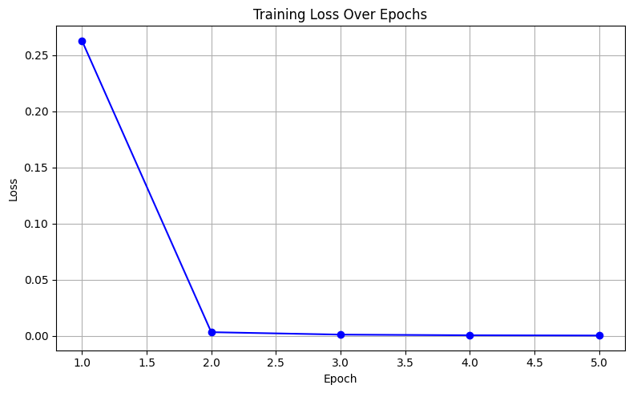
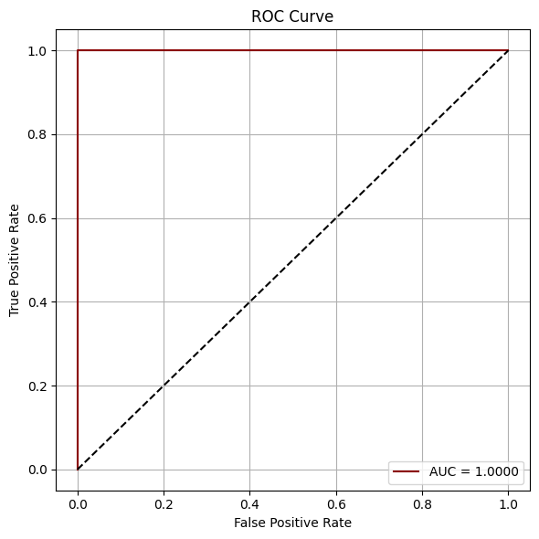
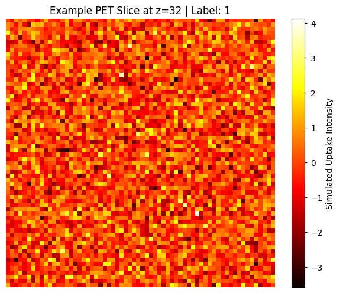

# Predicting Preclinical Neurodegeneration Using AI and 3D Brain Imaging

Researchers: Sinchana Joshi, Jachin Thilak, Tejshree Ratnakar, Sai Ganbote
Research Area: Computational Neuroscience and Artificial Intelligence  
Model: 3D Vision Transformer (ViT3D)  
Tools: Python, PyTorch, scikit-learn, Matplotlib

Overview:

This project explores the application of a three-dimensional Vision Transformer (ViT3D) to volumetric imaging classification, motivated by the potential of machine learning to investigate patterns associated with neurodegenerative disease.

The model processes 3D image patches using transformer encoder layers and generates binary classification predictions. The initial experiment uses synthetic PET-like volumes to test the model architecture and training pipeline.

Research Question:

Can a 3D Vision Transformer learn spatial patterns in volumetric imaging data, and how might this approach be evaluated for future neuroimaging research?

Methods:

- Generated 200 synthetic 3D volumes measuring 64 × 64 × 64 voxels.
  
- Introduced an artificial high-intensity region into samples assigned to the positive class.
  
- Divided volumes into 16 × 16 × 16 patches and projected them into 256-dimensional embeddings.
  
- Implemented a transformer with six encoder layers and eight attention heads using PyTorch.
  
- Trained the model for five epochs using the Adam optimizer and binary cross-entropy loss.
  
- Evaluated training behavior using loss tracking and ROC-AUC analysis.

Results and Figures:

Figure 1. Training Loss

Training loss decreased from 0.2627 in epoch 1 to 0.0004 in epoch 5, indicating that the model learned the synthetic classification task.

Figure 2. ROC Curve

The experiment produced a ROC-AUC of 1.0000 when evaluated on the same synthetic dataset used for training. This represents training-set performance and does not establish generalization to unseen data.

Figure 3. Synthetic Imaging Example

A representative slice from a simulated 3D volume. The image contains synthetic intensity values rather than actual patient imaging measurements.

Limitations:

This proof of concept uses synthetic data with an artificially introduced signal rather than real patient neuroimaging data. The evaluation also uses the training dataset rather than an independent test set. Therefore, the results do not establish the ability to detect microglial activation, predict preclinical neurodegeneration, or support clinical diagnosis.

Research Outputs:

- [View experiment](https://github.com/sinchujoshi24-ship-it/neurodegeneration-ai-prediction-model-stanford/main/Stanford_Internship.ipynb)
- [View Presentation](https://github.com/sinchujoshi24-ship-it/neurodegeneration-ai-prediction-model-stanford/blob/main/Neuroscience_Forum_Stanford.pdf.pdf)
- [View paper](https://www.researchgate.net/publication/397076724_Early_Detection_of_Neurodegenerative_Disease_via_AI-Decoded_Microglial_Activation_from_3D_Brain_Imaging)
